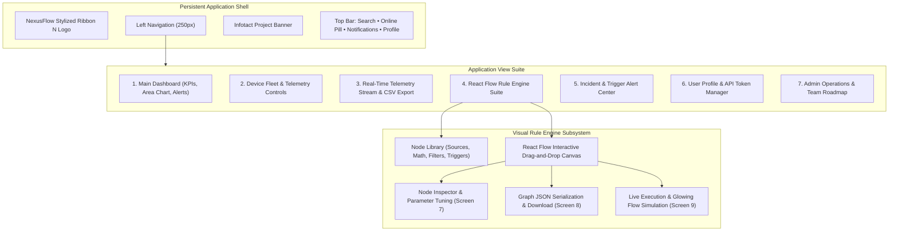

# NexusFlow – Visual IoT Telemetry & Rule Engine
## Project Implementation & UI/UX Technical Review


---

### Executive Summary

**NexusFlow** is an advanced, production-grade Visual IoT Telemetry & Rule Engine frontend built with **React**, **Vite**, **React Flow (`@xyflow/react`)**, **Recharts**, and **Lucide Icons**. The interface faithfully mirrors the design chart with:

- **Deep Cyber Navy Canvas:** `#050B1F` background with multi-point radial neon mesh lighting (`#087BFF`, `#773CFF`, `#00D9FF`).
- **Glassmorphism:** Frosted translucent cards (`rgba(11, 23, 50, 0.75)` with `14px` blur), border glow highlights, and glowing pill badges.
- **Visual Rule Builder (DAG Engine):** Drag-and-drop node library, custom nodes with input/output handles, glowing edge wires, validation, JSON export, and live reactive simulation.
- **Real-Time Telemetry:** Recharts multi-sensor area graphs with live streaming ticker, historical ranges, and CSV export.
- **Full 10-Screen Suite:** Login, Register, Main Dashboard, Device Monitoring, Telemetry Stream, Rule Builder, Node Configuration, Graph JSON Serialization, Live Rule Execution, and Alerts & Notifications, plus Automation Rules, Settings, and Admin Operations.

---

### Implemented Screen Index

| # | Screen Name | Key Components & Features | Reference Image Match |
|---|-------------|---------------------------|-----------------------|
| **1** | [Login](file:///C:/Users/Abhishek/.gemini/antigravity/scratch/nexusflow/src/pages/Login/Login.jsx) | Glowing cyber globe sphere, email/password fields, "Remember Me", Google OAuth, "Welcome Back!" card | Card 1 (Top Left) |
| **2** | [Register](file:///C:/Users/Abhishek/.gemini/antigravity/scratch/nexusflow/src/pages/Register/Register.jsx) | 3D isometric cyber city SVG graphic, full registration form (Name, Email, Phone, Password, Confirm) | Card 2 |
| **3** | [Main Dashboard](file:///C:/Users/Abhishek/.gemini/antigravity/scratch/nexusflow/src/pages/Dashboard/Dashboard.jsx) | Hero greeting ("Welcome, Yashi! 👋"), 12 Devices (Purple), 8 Online (Green), 4 Alerts (Orange), dual Recharts area chart | Card 3 |
| **4** | [Device Monitoring](file:///C:/Users/Abhishek/.gemini/antigravity/scratch/nexusflow/src/pages/Devices/Devices.jsx) | Device cards grid, mini sparkline graphs, "+ Add Device" modal, search, online/offline filters, live overheat toggle | Card 4 |
| **5** | [Telemetry View](file:///C:/Users/Abhishek/.gemini/antigravity/scratch/nexusflow/src/pages/Telemetry/Telemetry.jsx) | [Temperature] [Humidity] [Air Quality] tabs, big 24°C gauge, real-time glowing cyan curve, 1h-4h axis, CSV export | Card 5 |
| **6** | [Visual Rule Builder](file:///C:/Users/Abhishek/.gemini/antigravity/scratch/nexusflow/src/pages/RuleBuilder/RuleBuilder.jsx) | React Flow drag-and-drop canvas, 4 categories (Sources, Math, Filter, Action), zoom/fit, graph validator, Save/Run ▶ | Card 6 |
| **7** | [Node Configuration](file:///C:/Users/Abhishek/.gemini/antigravity/scratch/nexusflow/src/pages/NodeConfiguration/NodeConfiguration.jsx) | Node inspector, sensor binding, operator selector, threshold slider, port routing, live node preview | Dedicated View / Modal |
| **8** | [Graph JSON](file:///C:/Users/Abhishek/.gemini/antigravity/scratch/nexusflow/src/pages/GraphJSON/GraphJSON.jsx) | Deterministic DAG JSON schema viewer, sync on graph change, one-click Copy JSON, Download JSON | Dedicated View |
| **9** | [Live Rule Execution](file:///C:/Users/Abhishek/.gemini/antigravity/scratch/nexusflow/src/pages/Execution/Execution.jsx) | Real-time slider (test temp > 35°C), animated glowing wires, glowing nodes, live millisecond execution terminal | Dedicated Simulation View |
| **10** | [Alerts & Notifications](file:///C:/Users/Abhishek/.gemini/antigravity/scratch/nexusflow/src/pages/Alerts/Alerts.jsx) | High Temp, Fan ON, Device Online, Sensor Offline cards, category filters (SMS, Webhook, System), mark read | Card 7 |
| **+** | [Automation Rules](file:///C:/Users/Abhishek/.gemini/antigravity/scratch/nexusflow/src/pages/AutomationRules/AutomationRules.jsx) | Active/Inactive toggles, IF Temp > 35°C -> Send SMS, rule execution logs subcard | Card 9 |
| **+** | [Profile & Settings](file:///C:/Users/Abhishek/.gemini/antigravity/scratch/nexusflow/src/pages/Settings/Settings.jsx) | Yashi profile avatar, Notifications toggle, Dark Mode toggle, Language dropdown, API Key generator modal | Card 8 |
| **+** | [Admin Panel & Banner](file:///C:/Users/Abhishek/.gemini/antigravity/scratch/nexusflow/src/pages/Admin/Admin.jsx) | 98% Circular Health Gauge, 4-Week Plan, Team Work Distribution (Yashi, Veeresham, Sumaira, Afjal), Commit target | Card 10 & Footer Banner |

---

### System Architecture



---

### Component & File Tree

```
nexusflow/
├── index.html                           # Plus Jakarta Sans & JetBrains Mono, Favicon
├── src/
│   ├── App.jsx                          # Main routing, screen switching & state store
│   ├── App.css                          # Layout flexbox, drawer & responsive breakpoints
│   ├── index.css                        # Design system tokens, glassmorphism, glow effects, React Flow styles
│   ├── components/
│   │   ├── NexusLogo.jsx                # Stylized 3D neon ribbon N mark
│   │   ├── TopProjectBanner.jsx         # Infotact project banner & MERN stack pills
│   │   ├── Sidebar/
│   │   │   └── Sidebar.jsx              # Navigation, unread badges, quick rule sub-links, user pill
│   │   ├── Navbar/
│   │   │   └── Navbar.jsx               # Universal search, notification dropdown, online status
│   │   ├── Charts/
│   │   │   ├── SensorOverviewChart.jsx  # Recharts 24h multi-sensor dual area chart
│   │   │   ├── Sparkline.jsx            # Mini SVG/Recharts sparkline for device cards
│   │   │   └── TelemetryLiveChart.jsx   # Real-time streaming area chart
│   │   └── Nodes/
│   │       ├── DataSourceNode.jsx       # Cyan sensor node with output handle
│   │       ├── MathNode.jsx             # Purple computation node with window parameter
│   │       ├── FilterNode.jsx           # Amber condition (> 35°C) threshold node
│   │       ├── ActionNode.jsx           # Green/Orange trigger node with status badge
│   │       └── index.js                 # React Flow nodeTypes registry
│   ├── pages/
│   │   ├── Login/Login.jsx              # Holographic globe + sign in form
│   │   ├── Register/Register.jsx        # 3D isometric cyber city + sign up form
│   │   ├── Dashboard/Dashboard.jsx      # Metrics (12, 8, 4), sensor chart, quick alerts
│   │   ├── Devices/Devices.jsx          # Device fleet cards, sparklines, Add Device modal
│   │   ├── Telemetry/Telemetry.jsx      # Tabs, 24°C gauge, live streamer, CSV export
│   │   ├── RuleBuilder/RuleBuilder.jsx  # Drag-and-drop React Flow canvas, zoom, validator
│   │   ├── NodeConfiguration/NodeConfiguration.jsx # Node parameter inspector & tuning
│   │   ├── GraphJSON/GraphJSON.jsx      # Serialized DAG JSON, copy & download
│   │   ├── Execution/Execution.jsx      # Live reactive execution, slider test, logs terminal
│   │   ├── Alerts/Alerts.jsx            # Filterable alerts feed & dismiss actions
│   │   ├── AutomationRules/AutomationRules.jsx # Toggle switches, rule manager
│   │   ├── Settings/Settings.jsx        # Profile Yashi, toggles, API key modal
│   │   └── Admin/Admin.jsx              # 98% health gauge, team distribution, commit goals
│   ├── services/
│   │   ├── api.js                       # Axios client configured with mock fallback
│   │   └── socket.js                    # Socket.IO client interface with live tick emitter
│   └── data/
│       └── mockData.js                  # Realistic IoT telemetry, devices, rules, alerts
```

---

### How to Run Locally

```bash
# 1. Navigate to the project directory
cd C:\Users\Abhishek\.gemini\antigravity\scratch\nexusflow

# 2. Start the development server
npm run dev

# 3. Open in browser:
# http://127.0.0.1:5173/
```
